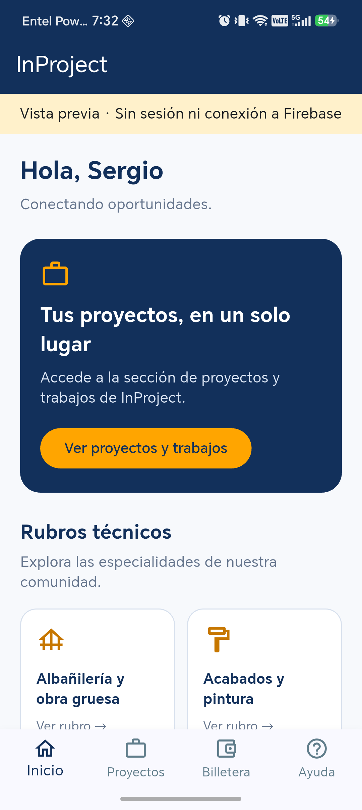
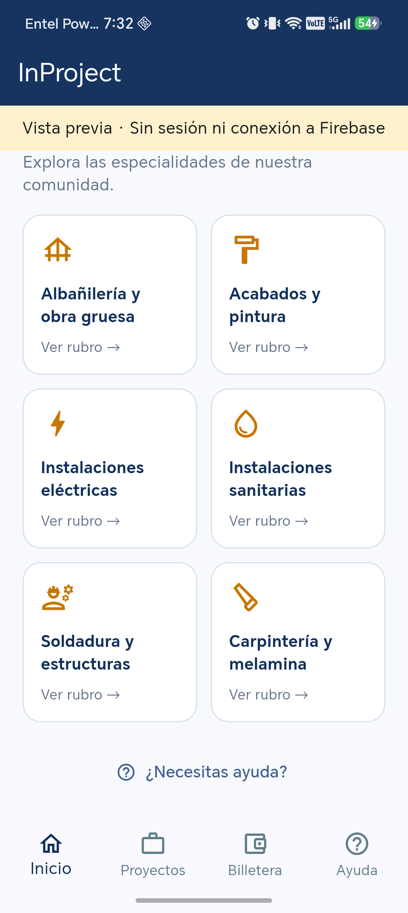
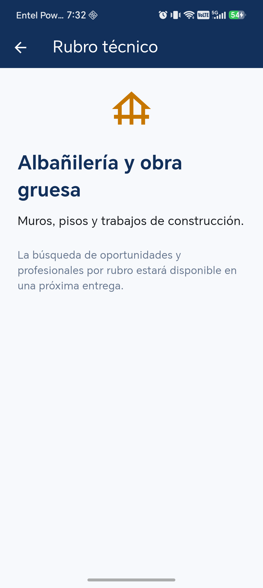
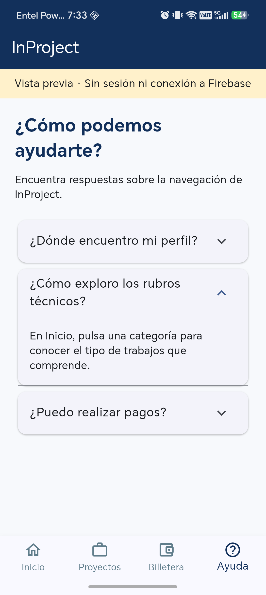

# Avance del panel móvil de INPROYECT

**Responsable:** Sergio Veliz

**Fecha de presentación:** 24 de noviembre de 2026

**Rama:** `desarrollo/panel-mockups`

**Base:** versión del compañero `79b4439`, carpeta `app/`.

## Resumen para la reunión

En esta entrega trabajé en el diseño y la navegación del panel posterior al ingreso,
tomando como referencia los colores y las seis categorías de los mockups compartidos.
Implementé la pantalla de inicio, el acceso al detalle de cada rubro y una sección de
ayuda con preguntas desplegables. La barra inferior ahora permite cambiar de sección.

Las capturas corresponden a la aplicación Flutter instalada y ejecutada en un celular
Android ABR NX3. Se utilizó una vista previa independiente para revisar estas pantallas
sin depender del login que continúa desarrollando el compañero.

## Evidencias, en orden

### 1. Inicio

Saludo de muestra, colores azul y naranja, tarjeta de acceso a proyectos y navegación inferior.
El nombre mostrado pertenece a la vista previa; no acredita una sesión autenticada.



### 2. Rubros técnicos

Seis categorías del mockup organizadas en tarjetas. Se puede desplazar la pantalla y
abrir cada rubro: albañilería, acabados, electricidad, instalaciones sanitarias,
soldadura y carpintería.



### 3. Detalle del rubro

Al pulsar una categoría se abre una pantalla con su descripción y una flecha para
regresar. La búsqueda de profesionales y oportunidades todavía está pendiente.



### 4. Ayuda

Preguntas desplegables sobre la navegación. Esta sección es informativa; no implementa
el bot ni las llamadas a un asesor que aparecen en el recorrido completo del mockup.



## Alcance y pendientes

- Funciona el recorrido Inicio → Rubro → Detalle → Volver y la navegación inferior.
- Proyectos y Billetera tienen pantallas de estado pendiente; no gestionan trabajos ni dinero.
- El login, registro y perfil del compañero no se modificaron en esta entrega.
- La configuración principal de `app/` apunta al nuevo Firebase `inproyect-24922`;
  las capturas usan `lib/main_preview.dart`, que no inicia Firebase.
- No se presenta como terminado el flujo completo de los mockups ni la autenticación.
- Próximo paso: confirmar la definición de roles con el equipo e implementar un
  recorrido de proyectos/trabajos con sus datos y permisos acordados.

## Validación realizada

- `flutter analyze --no-pub`: sin problemas.
- `flutter test --no-pub`: dos pruebas aprobadas (navegación y pantalla estrecha con texto ampliado).
- APK de depuración compilado, instalado y probado en el celular el 23 de noviembre.
- Capturas tomadas del mismo avance el 24 de noviembre de 2026.

## Cómo ejecutar

Abrir `InProject.code-workspace` y elegir **InProject · Vista previa del panel**.
También, desde `app/`:

```sh
flutter pub get
flutter run -t lib/main_preview.dart
```

Para el flujo real con Firebase se utiliza `lib/main.dart`, cuyo login aún requiere
coordinación y validación con el compañero.
